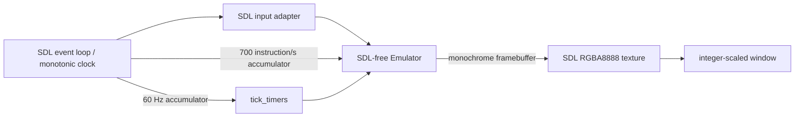

<!-- SPDX-FileCopyrightText: 2026 Manuel María Alconchel Fernánde -->
<!-- SPDX-License-Identifier: Apache-2.0 -->

# Architecture — iteration 1

The selected machine is CHIP-8: 4 KiB address space, 16 8-bit V registers, I and PC registers, 64×32 monochrome framebuffer, hexadecimal keypad, and 60 Hz delay/sound timers. Programs begin at `0x200`; the standard 4×5 font is stored at `0x000`. The implementation currently uses wrapping sprite coordinates and treats unsupported opcodes as controlled errors.

The core cycle is fetch two bytes at PC, increment PC by two, decode and execute; an error halts the core. The SDL-free scheduler receives bounded host-time deltas (100 ms maximum), advances instructions at the configured rate, and ticks timers at 60 Hz independently. `Velot8Emulator` owns all mutable machine state; SDL objects remain entirely inside the frontend.

The current phase implements baseline CHIP-8 instructions, stack safety, configurable quirk profiles, timers, SDL input and optional audio. CI is configured for Linux, macOS and Windows/MSYS2, but no remote run has been verified from this workspace. Remaining work includes compatibility regression ROMs with documented licenses, SDL video/audio/timing integration tests and a published compatibility matrix.
